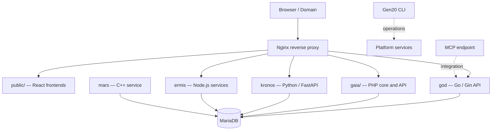

# GEN20

**A modular, database-centred platform for multi-domain applications.**

GEN20 brings together shared application services, reusable UI components (*Cubos*), domain frontends, and operational tooling in one evolving platform. It currently supports a CMS-style workflow with shared public/admin capabilities across multiple active domains.

> **Project status:** Active development. This README describes the known architecture and intended responsibilities of the main services. Deployment details, integrations, and security controls should be verified against the current production configuration before being treated as guarantees.

## Contents

- [Overview](#overview)
- [Architecture](#architecture)
- [Main services](#main-services)
- [Design principles](#design-principles)
- [MCP integration](#mcp-integration)
- [Development and operations](#development-and-operations)
- [Security notes](#security-notes)
- [Roadmap for repository documentation](#roadmap-for-repository-documentation)

## Overview

GEN20 is designed to support multiple web properties without duplicating every application capability for each domain. Shared services and administration sit alongside domain-specific React interfaces and APIs.

Key concepts:

- **Multi-domain:** shared platform capabilities serve several active domains.
- **Database-centred:** MariaDB is the primary relational data store.
- **Modular services:** components can be developed and operated according to their responsibilities.
- **Reusable Cubos:** reusable UI/application building blocks intended to reduce duplication.
- **Action-oriented automation:** CLI commands and CI workflows help standardise repeatable tasks.
- **Polyglot by design:** services use the language and runtime suited to their role.

## Architecture

The following is a high-level conceptual map, not a verified runtime/deployment diagram. Confirm actual request paths, ports, authentication, and dependencies from the current Nginx configuration, environment files, and service definitions.

The diagram communicates the known component roles. It does **not** imply that every service connects directly to MariaDB or that MCP is already fully connected to ChatGPT.

## Main services

| Component | Known role |
|---|---|
| `public/` | React frontends for the platform's domains. |
| `gaia/` | PHP core/API area and shared application functionality. |
| `god` | Go service using Gin; API and fast service operations. |
| `kronos` | Python service using FastAPI/Gunicorn; API and AI-oriented workloads. |
| `ermis` | Node.js services; communication and real-time capabilities are part of its intended scope. |
| `mars` | C++ service for performance-sensitive operations and database-related work. |
| MariaDB | Primary relational database. |
| Nginx | Front-facing web server/reverse proxy. |
| Gen20 CLI | Operational and development commands; command inventory needs updating. |
| GitHub Actions | CI/CD automation; workflows need review against the current repository layout. |

Service names and descriptions above summarise the intended responsibilities. Check the actual process/container definitions before relying on specific ports, health checks, startup order, or network paths.

## Design principles

1. **Shared platform, separate domains** — reuse core capabilities while keeping domain frontends manageable.
2. **Clear service boundaries** — document each service's API, dependencies, configuration, and ownership.
3. **Reusable building blocks** — evolve Cubos as documented, versioned components rather than undocumented copies.
4. **Explicit operations** — make setup, deployment, backups, and recovery reproducible.
5. **Security by default** — keep credentials out of source control and protect service endpoints.
6. **Documented reality over assumptions** — distinguish implemented behaviour from planned work.

## MCP integration

An MCP endpoint has been exposed at **https://gen20.net/mcp**. Endpoint reachability alone does not prove that an MCP client can complete the protocol handshake, authenticate, discover tools, and invoke them successfully.

Before considering the integration complete, verify:

- MCP transport and protocol compatibility with the intended ChatGPT connector.
- Authentication and authorization for every tool.
- Request validation, timeouts, and safe error handling.
- Logging that excludes secrets and sensitive payloads.
- Explicit allow-lists for operations; no unrestricted shell or database access.
- End-to-end tool discovery and invocation using a non-production test operation.

Do not put API keys, personal access tokens, passwords, private keys, or production environment values in this repository or in issue/PR comments. If a credential has been exposed, revoke it and create a replacement.

## Development and operations

The exact installation and deployment process should be documented from the current server setup rather than inferred from historical README instructions.

Before running or changing production services:

1. Inspect the current Git branch and working tree.
2. Confirm service definitions, environment variables, and reverse-proxy routes.
3. Check health endpoints and logs.
4. Back up the database and relevant configuration before migrations or deployment.
5. Test changes in a separate branch or staging environment.
6. Record rollback steps before release.

Useful areas to document next:

- Required OS/runtime versions and system packages.
- Local development setup and environment variable names (never their secret values).
- Service startup order, health checks, logs, and troubleshooting.
- Database migration, backup, restore, and recovery procedures.
- Release, deployment, rollback, and incident-response steps.
- CLI command reference with tested examples.

## Security notes

- Keep secrets in a secret manager or protected environment configuration; do not commit them.
- Use least-privilege credentials for database users, CI jobs, and external integrations.
- Authenticate and authorize administrative APIs and MCP tools.
- Restrict CORS, network exposure, file access, and outbound operations to what each service needs.
- Pin and regularly review dependencies and GitHub Actions.
- Review logs for accidental credential or personal-data exposure.
- Treat this README as documentation, not as evidence that each control is already implemented.

## Roadmap for repository documentation

Recommended follow-up work:

- [ ] Replace historical setup steps with a verified installation guide.
- [ ] Add `docs/ARCHITECTURE.md` with real request/data flows and service dependencies.
- [ ] Add `docs/OPERATIONS.md` covering health checks, logs, backup/restore, deployment, and rollback.
- [ ] Add `docs/SECURITY.md` for authentication, permissions, secret handling, and MCP threat boundaries.
- [ ] Rewrite `cli/README.md` as a current command reference.
- [ ] Audit GitHub Actions for current language versions, image names, path filters, permissions, and release behaviour.
- [ ] Move version history and older plans out of the main README into a maintained changelog/roadmap.
- [ ] Clearly label each major feature as implemented, in progress, or planned.

## Contributing

Use focused branches and pull requests. Include a short description of the change, testing performed, configuration or migration impacts, and any required rollback. Do not merge changes to production workflows or service configuration without reviewing their operational effects.

---

**GEN20** — shared platform capabilities, reusable components, and multi-domain applications.
